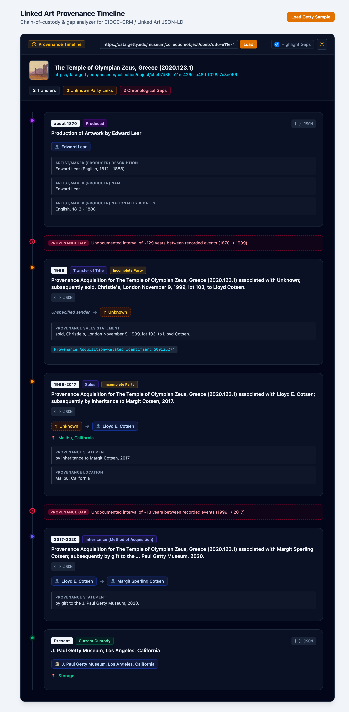

# Linked Art Provenance Timeline (`@micropasts/provenance-timeline`)

A standalone, framework-agnostic chain-of-custody and provenance timeline viewer for [Linked Art](https://linked.art/) JSON-LD cultural heritage records.

Built with zero runtime JavaScript dependencies and bundled Tailwind CSS v4—requiring no external CDN scripts or host-framework CSS setup.

* **Live Demo:** https://micropasts.github.io/provenance-timeline/
* **Repository:** https://github.com/micropasts/provenance-timeline
* **Author:** Daniel Pett ([MicroPasts](https://github.com/micropasts))


### Screenshot of interface




> [!TIP]
> Try this url in the interface for a more complex history: https://data.getty.edu/museum/collection/object/6bf04863-9fb1-40d7-a8d3-fba06b8c1b05
---

## Features

* **End-to-End Chain of Custody:** Automatically extracts and links an object's creation (`produced_by` / `created_by`), ownership transfers (`changed_ownership_through`), and current repository (`current_owner` / `current_keeper`) into a chronological vertical timeline.
* **Linked Art & Getty Pattern Support:** Resolves nested `Acquisition` events and parent `part_of` provenance `Activity` blocks, including transfer methods (`Sales`, `Inheritance`, `Gift`), `transferred_title_from` → `transferred_title_to` flows, geographic locations, bibliographic/sales statements (`referred_to_by`), and authority identifiers (such as ULAN IDs).
* **Chronological Sequence & Gap Detection:** Orders transfer events using graph sequence pointers (`starts_after_the_end_of` / `ends_before_the_start_of`) and ISO `timespan` dates (`begin_of_the_begin` / `end_of_the_end`), highlighting multi-year undocumented intervals (`Provenance Gap`) and transfers involving `"Unknown"` parties.
* **Per-Event Raw JSON-LD Inspection:** Every timeline card includes a `{ } JSON` toggle to inspect the underlying Linked Art JSON-LD snippet for that specific event.
* **Flexible Data Input:** Load Linked Art JSON-LD from a remote or local endpoint URL, via the built-in interactive URL bar, or programmatically from a JavaScript object or JSON string.
* **Scoped Light & Dark Mode:** Bundled Tailwind CSS with a built-in header theme toggle scoped to the component wrapper so it never collides with your host application's theme.

---

## Installation

Install the package via npm:

```bash
npm install @micropasts/provenance-timeline
```

---

## Quick Start

Import both the `ProvenanceTimeline` class and its bundled stylesheet:

```javascript
import { ProvenanceTimeline } from '@micropasts/provenance-timeline';
import '@micropasts/provenance-timeline/style.css';

// Initialize the timeline from a Linked Art endpoint URL
const timeline = new ProvenanceTimeline('#timeline', {
  url: 'https://data.getty.edu/museum/collection/object/cbeb7d35-e11e-426c-b48d-f028a7c3e056',
  theme: 'dark',
  showUrlInput: true,
  showGaps: true,
});
```

Ensure your HTML contains the target mount element:

```html
<div id="timeline"></div>
```

---

## How It Works

When a Linked Art JSON-LD document is passed via `url` or `setData()`, `parseLinkedArtProvenance()` normalizes the graph into a linear custody sequence in four stages:

1. **Origin Extraction (`produced_by` / `created_by`):** Extracts the maker(s) (`carried_out_by`), production date (`timespan`), place (`took_place_at`), and descriptive notes to anchor the start of the object's biography.
2. **Transfer Extraction (`changed_ownership_through`):** Iterates through each `Acquisition` event and inspects any parent `part_of` provenance `Activity` block to gather:
   * **Parties:** Maps `transferred_title_from` and `transferred_title_to` actors, flagging `"Unknown"` parties as incomplete custody links.
   * **Acquisition Method:** Reads `classified_as` terms (e.g., *Sales*, *Inheritance*, *Gift*).
   * **Context & Statements:** Collects sales notes, provenance statements, and location statements from `referred_to_by` (filtering out `deprecated` statements) alongside authority identifiers (`identified_by`).
3. **Chronological Sorting & Gap Analysis:** Sorts transfers using `starts_after_the_end_of` / `ends_before_the_start_of` sequence pointers first, falling back to parsed `timespan` years (`begin_of_the_begin` / `end_of_the_end`). Whenever consecutive recorded events are separated by 15 or more years, a **Provenance Gap** alert card is inserted between them.
4. **Current Custody (`current_owner` / `current_keeper`):** Appends the present holding institution and `current_location` at the end of the timeline.

---

## Usage Patterns

### 1. Parse from a JavaScript Variable (Object or JSON String)

Pass a pre-loaded JSON-LD object or raw JSON string via the `data` option at initialization, or update an existing instance at any time with `setData()`:

```javascript
import { ProvenanceTimeline } from '@micropasts/provenance-timeline';
import '@micropasts/provenance-timeline/style.css';

const record = {
  '@context': 'https://linked.art/ns/v1/linked-art.json',
  id: 'https://example.org/object/1',
  type: 'HumanMadeObject',
  _label: 'Landscape Drawing',
  produced_by: {
    type: 'Production',
    _label: 'Production by Artist',
    timespan: { begin_of_the_begin: '1870-01-01T00:00:00' },
    carried_out_by: [{ type: 'Person', _label: 'Edward Lear' }],
  },
  changed_ownership_through: [
    {
      type: 'Acquisition',
      _label: 'Sold at Auction, 1999',
      classified_as: [{ type: 'Type', _label: 'Sales' }],
      timespan: { begin_of_the_begin: '1999-11-09T00:00:00' },
      transferred_title_from: [{ type: 'Person', _label: 'Unknown' }],
      transferred_title_to: [{ type: 'Person', _label: 'Private Collector' }],
    },
  ],
  current_owner: [
    { type: 'Group', _label: 'J. Paul Getty Museum' },
  ],
};

const timeline = new ProvenanceTimeline('#timeline', {
  data: record,
  showUrlInput: false, // Hide the URL bar when using local data only
});

// Swap in a different record later
timeline.setData(anotherRecord);
```

### 2. Custom Fetch Headers & Authentication

Pass standard `fetch()` options (such as credentials or authorization headers) via `fetchOptions`:

```javascript
const timeline = new ProvenanceTimeline('#timeline', {
  url: '/api/private/linked-art/123',
  fetchOptions: {
    credentials: 'same-origin',
    headers: {
      'X-Requested-With': 'XMLHttpRequest',
    },
  },
});
```

### 3. Framework Integration Examples

#### Vanilla HTML / UMD Script Tag

```html
<link rel="stylesheet" href="./node_modules/@micropasts/provenance-timeline/dist/provenance-timeline.css" />
<div id="timeline"></div>

<script src="./node_modules/@micropasts/provenance-timeline/dist/provenance-timeline.umd.cjs"></script>
<script>
  const timeline = new ProvenanceTimeline.ProvenanceTimeline('#timeline', {
    url: 'https://data.getty.edu/museum/collection/object/cbeb7d35-e11e-426c-b48d-f028a7c3e056',
  });
</script>
```

#### React

```jsx
import { useEffect, useRef } from 'react';
import { ProvenanceTimeline } from '@micropasts/provenance-timeline';
import '@micropasts/provenance-timeline/style.css';

export function ObjectProvenance({ url, data, theme = 'dark' }) {
  const containerRef = useRef(null);
  const instanceRef = useRef(null);

  useEffect(() => {
    if (!containerRef.current) return;
    instanceRef.current = new ProvenanceTimeline(containerRef.current, {
      url,
      data,
      theme,
    });
  }, []);

  useEffect(() => {
    if (instanceRef.current && data) {
      instanceRef.current.setData(data);
    }
  }, [data]);

  useEffect(() => {
    if (instanceRef.current) {
      instanceRef.current.setTheme(theme);
    }
  }, [theme]);

  return <div ref={containerRef} />;
}
```

#### Vue 3

```vue
<script setup>
import { onMounted, ref, watch } from 'vue';
import { ProvenanceTimeline } from '@micropasts/provenance-timeline';
import '@micropasts/provenance-timeline/style.css';

const props = defineProps({
  url: String,
  data: Object,
  theme: { type: String, default: 'dark' },
});

const container = ref(null);
let instance = null;

onMounted(() => {
  instance = new ProvenanceTimeline(container.value, {
    url: props.url,
    data: props.data,
    theme: props.theme,
  });
});

watch(() => props.data, (newData) => {
  if (instance && newData) instance.setData(newData);
});

watch(() => props.theme, (newTheme) => {
  if (instance) instance.setTheme(newTheme);
});
</script>

<template>
  <div ref="container" />
</template>
```

---

## Configuration Options

Pass these options as the second argument to `new ProvenanceTimeline(target, options)`:

| Option | Type | Default | Description |
| :--- | :--- | :--- | :--- |
| `url` | `string` | `''` | Linked Art JSON-LD endpoint URL to fetch immediately on mount. |
| `data` | `object \| string \| null` | `null` | Pre-loaded Linked Art JSON-LD object or JSON string. Takes precedence over `url` on initial render. |
| `theme` | `'light' \| 'dark'` | `'dark'` | Initial color theme of the timeline UI. Users can switch themes via the header toggle button. |
| `showUrlInput` | `boolean` | `true` | Displays an interactive URL input bar and **Load** button in the header. |
| `showGaps` | `boolean` | `true` | Displays `Provenance Gap` callout cards between chronological intervals of 15+ years. Users can toggle this via the **Highlight Gaps** checkbox. |
| `fetchOptions` | `RequestInit` | `{}` | Additional options passed to `fetch()` when requesting `url` (e.g., `headers`, `credentials`). |

---

## Instance Methods

Once instantiated (`const timeline = new ProvenanceTimeline(...)`), the following methods are available:

| Method | Signature | Description |
| :--- | :--- | :--- |
| `loadUrl(url)` | `(url: string) => Promise<void>` | Fetches Linked Art JSON-LD from `url` and renders the timeline. |
| `setData(json)` | `(json: object \| string) => void` | Parses and renders a JSON-LD object or JSON string immediately. |
| `setTheme(theme)` | `(theme: 'light' \| 'dark') => void` | Sets the viewer theme (`'light'` or `'dark'`). |
| `toggleTheme()` | `() => void` | Toggles between `'light'` and `'dark'` themes. |

---

## Visual Indicators

* **Purple Rail Node:** Object origin (`Production` / `Creation`).
* **Indigo Rail Node:** Documented ownership transfer (`Acquisition` / `Transfer of Title`).
* **Amber Rail Node & Dashed Party Chip:** Ownership transfer involving an `"Unknown"` party (`Incomplete Party`).
* **Rose Dashed Callout Card:** Chronological `Provenance Gap` between recorded dates.
* **Emerald Rail Node:** Present repository / `Current Custody`.

---

## Development & Building

```bash
# Install dependencies
npm install

# Start local dev sandbox (serves index.html)
npm run dev

# Build npm library bundle (outputs to dist/)
npm run build

# Build static GitHub Pages demo site (outputs to docs/)
npm run build:docs
```

---

## License

This project is licensed under the **Mozilla Public License Version 2.0 (MPL-2.0)** — see the [LICENSE.md](./LICENSE.md) file for details.